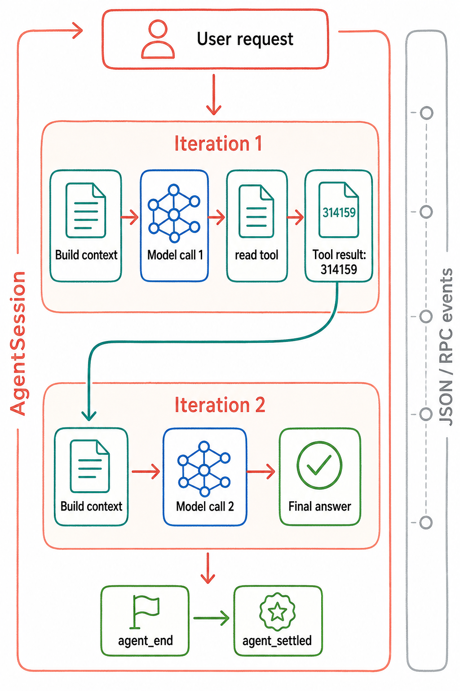

# 一次请求的运行过程

图按时间顺序展示历史 R-002：第一次响应请求 read，工具结果进入第二次模型请求，随后依次结束低层运行和产品收尾。AgentSession 是产品编排层，toolResult 是工具返回的消息。证据：S-001、S-002、R-002；图中未加入该场景没有触发的压缩或重试。图片经本次复核后继续使用，[提示词与审核记录](../diagrams/generated/metadata.json)。

这里用历史 `R-SCENARIO-002` 串起当前 Coding Agent 的主路径。场景只开放 `read`，要求读取合成文件并返回其中的 `314159`。归一化轨迹记录了两轮模型处理、一次工具调用和最终 settled；源码补充轨迹中看不到的状态所有权。[R: R-002]

## 从输入到第一次模型请求

CLI 创建或打开 session 后，print/JSON 模式调用 `AgentSession.prompt()`。产品层依次处理 extension command、`input` hook、skill/template 展开；若已有运行，则把新输入交给指定队列。普通空闲路径检查模型和鉴权，必要时处理旧上下文，然后构造 user message，追加待发送的消息和 `before_agent_start` 返回的内容。[S: S-002]

`AgentSession._runAgentPrompt()` 调用 `Agent.prompt()`。后者建立当前 context/config 快照，交给 `runAgentLoop()`。每次模型请求前，消息先经过 `transformContext`，再经 `convertToLlm` 转为 provider 支持的消息；system prompt 和 active tools 一并传入模型适配层。[S: S-001, S-022, S-024]

本场景关闭了 skills、extensions、prompt templates 和 context files。上面这些入口是源码中的完整输入路径，真实轨迹实际经过的是其中的最小配置。

## 模型请求读取文件之后

模型第一轮返回 assistant message，其中包含 `read` 调用。低层循环等这条 assistant message 完成后才组织工具批次。

1. 发出 `tool_execution_start`，按名称查找工具并校验参数。
2. 执行可选的 `beforeToolCall`；在产品层，它对应 extension 的 `tool_call` hook。
3. 调用 `read.execute`，获得文件内容，之后应用可选的 result hook。
4. 发出执行结束事件，构造对应的 `toolResult`，把它交回消息处理和上下文。
5. 进入下一轮模型请求。此时模型能看到前一条工具调用和它的结果。[S: S-001, S-003, S-018]

`Agent` 在 `message_end` 时更新内存消息。`AgentSession` 等待 extension 的消息处理后把消息交给 `SessionManager`。本场景使用 `--no-session`，因此有内存消息处理而没有普通会话文件写入。[S: S-019; R: R-002]

## 第二次请求为何会发生

工具批次完成后，低层循环把 `toolResult` 加入 context，并检查是否还需继续。这个 read 场景继续请求模型，第二条 assistant message 给出最终文本。没有新的工具调用或排队输入后，低层循环发出 `agent_end`；产品层处理完后续工作，再发出 `agent_settled`。[R: R-002; S: S-001, S-002]

| 轨迹中的步骤 | 消息或状态变化 |
|---|---|
| 用户输入 | user message 进入本次运行 |
| 第一次 assistant 完成 | 历史中增加带 `read` 调用的 assistant message |
| read 结束 | 增加包含合成文件值的 toolResult |
| 第二次 assistant 完成 | 增加最终回答 |
| `agent_end` / `agent_settled` | 低层运行结束，再完成产品层收尾 |

完整事件见[归一化轨迹](../traces/normalized/R-002-read-tool.normalized.jsonl)。归一化文件保留事件类型和统计字段；合成文本及工具结果位于对应 raw 记录。它没有捕获完整 HTTP 请求包，因此“请求怎样构造”同时依据源码解释。

## 接下来需要分开的路径

压缩、重试、动态工具更新和分支恢复在其他章节单独解释。该 read 场景没有触发这些行为。新的本地 mock/faux 测试进一步检查了并行结果顺序、异步事件处理、压缩后续行为和会话树重建，见[实验记录](11-runtime-experiments.md)。
