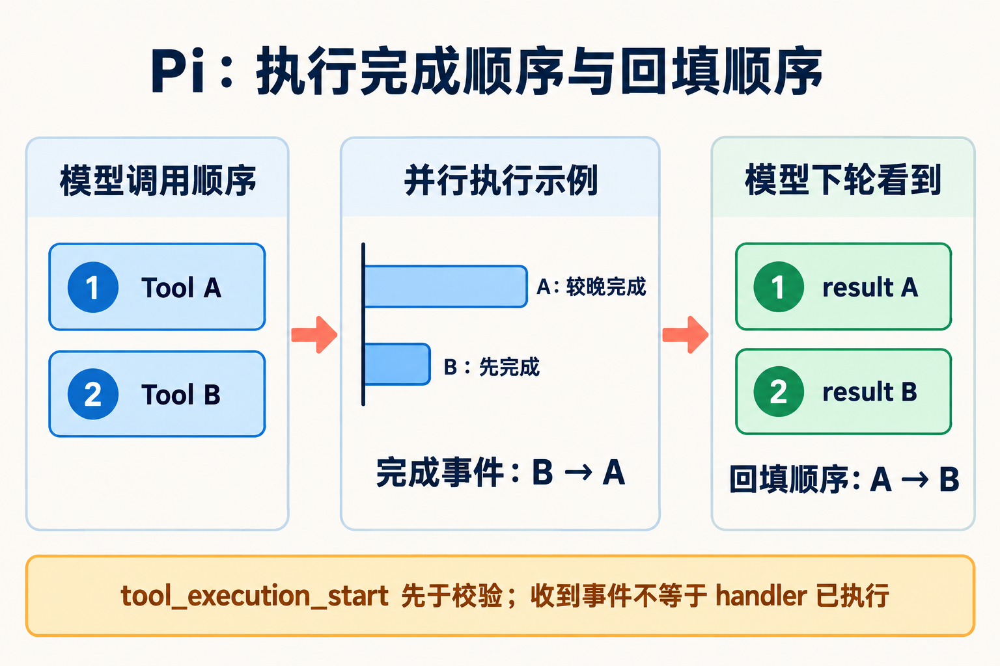

# 核心循环与工具执行

`runAgentLoop()` 接收本次输入、当前 context、模型及工具配置、事件接收函数和取消信号。它为消息数组建立本轮视图，发出起始事件，然后交给 `runLoop()`。`Agent` 是这个循环的状态包装，产品层的压缩和重试由 `AgentSession` 在其外部处理。[S: S-001, S-002, S-019]

## 一轮模型处理的顺序

1. 把待注入的 steering/follow-up 消息加入当前 context。
2. 先运行 `transformContext`，再运行 `convertToLlm`，与 system prompt 和 tools 组成请求。
3. 消费 provider stream：开始时加入部分 assistant message，delta 更新它，结束时用最终 message 替换。
4. 若 stop reason 是 `error` 或 `aborted`，结束本次低层运行。
5. 从完整 assistant message 取出 `toolCall`，组织工具批次并生成 `toolResult`。
6. 回填结果，发出 `turn_end`，调用 `prepareNextTurn` 刷新下一请求需要的配置。
7. 检查 host 的停止条件及 steering；内层可结束时，再检查 follow-up 队列。[S: S-001]

源码：[runLoop](https://github.com/earendil-works/pi/blob/818d67457cdd6b60bce6b121d16b23141c252dd8/packages/agent/src/agent-loop.ts#L161)。这里的工具执行发生在 assistant response 完成之后；工具参数的流式增量本身不会立即触发 handler。

## 工具处理包含准备和执行两个阶段

每个调用先发出 `tool_execution_start`，再查找名称、执行可选的 `prepareArguments`、校验 schema、调用 `beforeToolCall` 并检查 abort。未知工具、非法参数、hook block 或准备阶段异常可以直接生成错误结果，不进入 `execute`。[S: S-018]

准备通过后，`execute` 获得 call id、校验后的参数、取消信号和进度回调。handler 抛出的异常被包装为错误结果；实际执行的调用随后进入 `afterToolCall`，允许调整 content、details、terminate 和 isError。最后发出结束事件并生成协议消息。

因此 `tool_execution_start` 的准确含义是“开始处理这个调用”。判断命令或文件操作是否发生，要结合 execute 计数、实际输出或副作用记录。`length` 截断路径也会发出 start/end，同时返回“未执行”的错误内容。[C: C-021; S: S-018]

## 并发完成与消息顺序



A、B 是说明顺序的示例：B 可以先完成，但 toolResult 按模型调用次序 A、B 回填。时间条不表示实测耗时；tool_execution_start 只表示开始处理调用。证据：S-018、X-004。[提示词、生成参数与复核记录](../diagrams/generated/metadata.json)。

默认并行路径先按调用顺序完成各项准备，再启动允许执行的函数。`tool_execution_end` 可按实际完成顺序出现；`Promise.all` 保存原调用位置，随后按位置生成 `toolResult` 消息。

例如模型依次请求 A、B，B 先完成时，结束通知可以是 B、A，但下一轮模型看到的结果仍是 A、B。界面进度与模型上下文因此有不同的排序依据。本次 `X-004` 重新执行了相关定向测试。[C: C-015; S: S-018; X: X-004]

若全局 `toolExecution` 为 sequential，或批次中任一命中工具声明 `executionMode=sequential`，整个批次进入串行路径。串行路径每次准备并执行一个调用，处理结果后再进入下一个。

## 继续、终止与排队输入

有工具调用通常会触发下一次模型请求。一个特殊条件是已处理批次中的所有结果都声明 `terminate=true`，这会关闭工具引起的 follow-up；它仍需结合 steering、follow-up 和 host 停止条件判断整个运行是否结束。普通工具错误通常作为 `isError` 结果回到模型，使其有机会继续处理。bash 内部命令的网络错误也走这条路径；产品层重试 LLM API 请求是另一层处理，见[具体例子](10-implementation-details.md#bash-联网失败和模型-api-失败分别怎么处理)。[S: S-018, S-034]

steering 在当前 assistant 及其工具批次完成后的边界注入；它不会仅因入队就打断正在执行的工具。follow-up 在工具与 steering 都耗尽后取出。`Agent.continue()` 若发现最后一条是 assistant，会先尝试消费队列；没有可消费输入才拒绝从该状态继续。[S: S-001; X: X-004]

## 双队列对应两种交互意图

[Haochuan 的源码解读](https://blog.haochuanz.net/posts/agent-harness-04-pi)把两类队列理解为用户控制运行节奏的接口。[I: I-002]

在当前默认交互界面中，队列由提交动作选择；在 SDK/RPC 中，则由调用方指定。默认路径没有按消息语义调用 LLM 分类这一步。以下说明普通文本输入，extension command 或 input hook 可以提前处理输入。[S: S-002, S-033]

| Pi 正在运行时的默认操作 | 界面传入的参数 | 入队结果 |
|---|---|---|
| Enter 提交 | streamingBehavior: "steer" | steering 队列，在当前 turn 边界后注入 |
| Alt+Enter 提交 | streamingBehavior: "followUp" | follow-up 队列，在工具与 steering 耗尽时消费 |

对应的两种调用形式是：

```ts
session.prompt(text, { streamingBehavior: "steer" })
session.prompt(text, { streamingBehavior: "followUp" })
```

`AgentSession.prompt()` 检查 `isStreaming` 后，按 `options.streamingBehavior` 选择 `_queueSteer()` 或 `_queueFollowUp()`。运行中的普通 prompt 没有提供这个参数时会报错。SDK 也提供 `session.steer()`、`session.followUp()`，RPC 提供 `steer`、`follow_up` 命令。[S: S-033]

### 同一句话可以进入不同队列

以“忙完之后，再检查文档”为例：按 Enter 会进入 steering，消息可能在下一次模型请求中就出现；模型收到后是否按文字要求推迟执行，是模型的行动选择。按 Alt+Enter 则进入 follow-up，程序把消息本身延后递交。

因此，程序控制“何时让模型看到消息”，模型在看到消息后判断“如何回应和行动”。即使文字写着“立即改变方向”，用 follow-up 方式提交也会先按该队列的时机等待。[S: S-001, S-033]

### 空闲、压缩与可配置键位

这些按键是默认绑定，可以通过 keybindings 调整。空闲时，Alt+Enter 会调用普通提交入口，开始处理新请求。压缩期间，交互层先保存消息及其 steer/followUp 模式，之后再按该模式递交；类型仍来自用户的提交动作。[S: S-033]

队列的消费时机由低层 loop 控制：steering 不自动撤销已经执行的动作，follow-up 也不必等到产品层 `agent_settled` 才被消费。它可以在同一低层运行发出 `agent_end` 前进入下一轮。[S: S-001; X: X-004]

源码：[Enter 的运行中提交](https://github.com/earendil-works/pi/blob/818d67457cdd6b60bce6b121d16b23141c252dd8/packages/coding-agent/src/modes/interactive/interactive-mode.ts#L2800)、[handleFollowUp](https://github.com/earendil-works/pi/blob/818d67457cdd6b60bce6b121d16b23141c252dd8/packages/coding-agent/src/modes/interactive/interactive-mode.ts#L3669)、[AgentSession 分流](https://github.com/earendil-works/pi/blob/818d67457cdd6b60bce6b121d16b23141c252dd8/packages/coding-agent/src/core/agent-session.ts#L1120)。

## 消息如何同步到 session

`Agent.processEvents()` 先把最终消息放入 live state，再逐个等待监听者。`AgentSession` 先等待 extension 的 `message_end`，必要时就地替换同一个消息对象，再通知外部监听者并追加 session entry。这样低层循环、产品层和持久化可以处理同一最终消息。[S: S-019]

本次异步 hook 回归测试检查了 assistant/toolResult 记录顺序，以及 `tool_call` hook 运行时 assistant 消息已进入会话分支。外部 session listener 则在 append 前被通知，不能仅凭回调开始就判断磁盘已经更新。[C: C-022; X: X-005]
