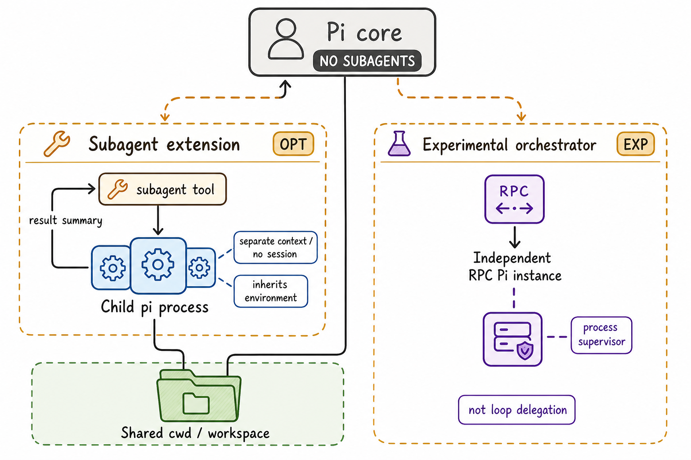

# 子代理与多进程编排

图展示源码中的两条可选路径：subagent extension 启动独立 child 并默认共享 cwd；orchestrator 管理独立 RPC Pi 实例。OPT 表示可选扩展，EXP 表示实验性实现，RPC 是进程间命令与事件通道。本次未运行这两条路径；证据：D-004、D-006、D-010、S-015、S-016。图片经本次复核后继续使用，[提示词与审核记录](../diagrams/generated/metadata.json)。

Pi v0.80.7 的默认 Coding Agent 不提供内置 subagent 工具。仓库另有 subagent extension 示例和实验性 orchestrator：前者让模型通过一个工具委托任务，后者管理多个 RPC Pi 实例。[D: D-004, D-006, D-010]

## Subagent extension 怎样启动任务

父代理调用 extension 注册的 `subagent` 工具后，示例按 agent name 找到定义，把任务交给一个独立 Pi 子进程。参数包括 `--mode json -p --no-session`；定义中的 model/tools 可进入子进程参数，system prompt 通过临时文件追加。

`getPiInvocation()` 尝试复用当前脚本与 runtime，或使用打包后的可执行文件，最后回退到 PATH 中的 `pi`。子进程 cwd 由任务参数指定，未指定时使用 parent 的默认 cwd。`spawn` 没有设置独立 env，因此通常继承父进程环境。[S: S-015]

源码：[runSingleAgent](https://github.com/earendil-works/pi/blob/818d67457cdd6b60bce6b121d16b23141c252dd8/packages/coding-agent/examples/extensions/subagent/index.ts#L268)。

## 隔离和共享分别发生在哪里

| 维度 | 示例中的行为 |
|---|---|
| 进程 | 每个任务启动独立 Pi 子进程 |
| 模型上下文 | 新建 child 消息，不自动复制 parent 全部 history；task 和 chain 的前序输出显式传入 |
| 会话文件 | `--no-session`，通过父工具结果回收输出 |
| 工作区 | 默认共享 cwd，也可由单项任务覆盖 |
| 权限与环境 | 通常同一 OS user，继承进程环境；工具名单不构成 OS sandbox |
| 返回通道 | 解析 JSON 事件，收集 assistant 消息、usage、工具调用和最终结果 |

示例支持 single、parallel 和 chain。parallel 的任务数与并发数由示例常量限制；chain 逐项把前序结果传给下一项。它们改变任务组织方式，没有自动为共享文件建立冲突管理。

取消时示例向直接 child 发送 SIGTERM，五秒后按 `proc.killed` 条件尝试 SIGKILL。该标记与进程是否真正退出不是同一个判断；这里没有运行挂起进程测试，因此不把这一逻辑写成保证清理整个进程树。[S: S-015]

## Orchestrator 管理的是实例

`OrchestratorSupervisor` 为每个 instance 创建 RPC Pi 进程，转发事件和 UI 请求，维护 instance/session 元数据并处理进程退出。启动恢复会把先前处于 online/starting 的记录标为 stopped；这不恢复子进程当时的在途模型请求。[S: S-016]

这两条路径本次均为静态复核，未启动 child 或 orchestrator。它们的入口、context、工作区和恢复语义与默认单 session 路径分开记录。
