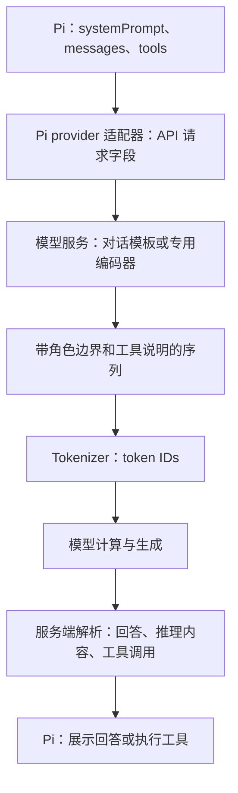

# 从 Pi 的请求到模型真正收到的输入

Pi 已经选好历史、放入压缩摘要，也准备好了 system prompt 和工具定义。它们怎样一起交给模型？这一步跨过了 Harness 与模型服务的边界：Pi 组织 API 请求，服务端再按模型的对话格式编码，模型最终处理 token 序列。[C: C-030]

这里沿用“检查 Docker 配置”的例子。Pi 部分仍固定在 `v0.80.7 / 818d674`；模型侧对照的是 2026-10-21 查阅的 Qwen3.8-27B 官方模板和 DeepSeek V4 Flash 公开参考编码器。下文是源码串讲与简化示例，没有执行这两个模型，也没有抓取云端实际 prompt。外部 main 文件的版本边界与来源见[查阅记录](../evidence/model-input-sources.json)。

## 三份字段怎样变成一条模型输入

在 Pi 的统一接口层，请求 context 分别携带 `systemPrompt`、`messages` 和 `tools`。低层循环先处理消息转换，再把它们一起交给模型调用入口。之后还需要两次不同的转换：[S: S-001, S-037; D: D-013]



对纯文本聊天，模板负责把角色和内容排成模型训练时使用的格式，tokenizer 再把它转成 token IDs。模型使用这些输入及已经生成的内容，继续预测后续 token。图中的边界表示职责；具体部署可能将多个阶段封装在同一个服务中。[对话模板](https://huggingface.co/docs/transformers/main/en/chat_templating)、[文本生成](https://huggingface.co/docs/transformers/main/en/llm_tutorial)

## Pi 发出去的仍然是结构化请求

选择 OpenAI 兼容 Chat Completions 接口时，下面是一份简化的请求体。模型名称是占位符，摘要和工具说明是教学内容，省略鉴权、采样和思考参数。

```json
{
  "model": "MODEL_NAME",
  "messages": [
    {
      "role": "system",
      "content": "你是代码助手。先检查文件，再回答问题。"
    },
    {
      "role": "user",
      "content": "历史摘要：正在排查启动端口，已确认生产环境 PORT=8080。"
    },
    {
      "role": "user",
      "content": "请继续检查 Docker 配置。"
    }
  ],
  "tools": [
    {
      "type": "function",
      "function": {
        "name": "read",
        "description": "读取指定文件的内容",
        "parameters": {
          "type": "object",
          "properties": {"path": {"type": "string"}},
          "required": ["path"]
        }
      }
    }
  ]
}
```

Pi 的 `openai-completions` 适配器将独立的 `systemPrompt` 放进 system 或 developer 消息，具体角色取决于模型和兼容配置；这里采用 system。工具的名称、描述和参数 schema 则进入独立的 `tools` 字段，工具执行函数不在其中。这是已检查的一个适配实现，实际入口还要看 [compat 的分派条件](05-models-tools-extensions.md#当前模型请求怎样分派)。[S: S-037]

源码：[Context 组装](https://github.com/earendil-works/pi/blob/818d67457cdd6b60bce6b121d16b23141c252dd8/packages/agent/src/agent-loop.ts#L287)、[system 消息转换](https://github.com/earendil-works/pi/blob/818d67457cdd6b60bce6b121d16b23141c252dd8/packages/ai/src/api/openai-completions.ts#L878)、[工具定义转换](https://github.com/earendil-works/pi/blob/818d67457cdd6b60bce6b121d16b23141c252dd8/packages/ai/src/api/openai-completions.ts#L1101)。

## 同一份内容进入 Qwen3.8-27B

查阅的官方模板在启用工具时，先写入可选思考强度指令、工具定义与调用格式要求，再接应用提供的 system 文本。下面保留主要边界，方括号表示省略内容；末尾采用开启思考的生成前缀。[S: S-038]

```text
<|im_start|>system
〔可选的 reasoning effort 指令〕
# Tools
〔工具使用说明〕
<tools>
〔read 工具的 JSON schema〕
</tools>
〔工具调用格式要求〕

你是代码助手。先检查文件，再回答问题。
<|im_end|>
<|im_start|>user
历史摘要：正在排查启动端口，已确认生产环境 PORT=8080。
<|im_end|>
<|im_start|>user
请继续检查 Docker 配置。
<|im_end|>
<|im_start|>assistant
<think>
```

API 中单独传输的 tools，在这里已经进入 system 段。模型若选择读文件，生成的调用片段可以采用以下格式，再由服务端解析成结构化 `tool_calls`：

```text
<tool_call>
<function=read>
<parameter=path>
Dockerfile
</parameter>
</function>
</tool_call>
```

工具执行后，API 里的 tool 消息由此模板包装为 user 段中的 `<tool_response>`。因此，API 返回的调用 JSON 与模型原始生成文本、API 消息角色与最终序列标记，分别属于不同表示。[Qwen3.8-27B 官方模板](https://huggingface.co/Qwen/Qwen3.8-27B/blob/main/chat_template.jinja)

## 同一份内容进入 DeepSeek V4 Flash

公开参考编码器采用另一套标记。普通 system 消息先写正文，再附工具说明；下例同样开启思考，未加入 max effort 的额外前缀。[S: S-039]

```text
<｜begin▁of▁sentence｜>
你是代码助手。先检查文件，再回答问题。

## Tools
〔DSML 调用格式说明〕
### Available Tool Schemas
〔read 的函数定义与参数 schema〕

<｜User｜>历史摘要：正在排查启动端口，已确认生产环境 PORT=8080。
<｜User｜>请继续检查 Docker 配置。
<｜Assistant｜><think>
```

该编码器内部把 tools 放在 system 消息上参与渲染；这是参考函数的输入结构，不能直接照搬为 HTTP 请求体。它生成和解析的工具调用使用 DSML，例如：

```text
<｜DSML｜tool_calls>
<｜DSML｜invoke name="read">
<｜DSML｜parameter name="path" string="true">Dockerfile</｜DSML｜parameter>
</｜DSML｜invoke>
</｜DSML｜tool_calls>
```

工具结果经过预处理，变成 user 内容中的 `<tool_result>` 块。公开实现提供了从消息到序列、再从生成文本到结构化结果的两向转换。[参考编码器](https://huggingface.co/deepseek-ai/DeepSeek-V4-Flash/blob/main/encoding/encoding_dsv4.py)、[格式说明](https://huggingface.co/deepseek-ai/DeepSeek-V4-Flash/blob/main/encoding/README.md)

两种示例最容易混淆的位置，可以放在一起对照：

| 位置 | Qwen3.8-27B 查阅模板 | DeepSeek V4 Flash 查阅编码器 |
|---|---|---|
| 角色边界 | im_start / im_end | User / Assistant 等专用标记 |
| 工具定义 | 本例中位于 system 段内、应用 system 文本之前 | 本例中附在 system 文本之后 |
| 工具调用 | tool_call、function、parameter | DSML tool_calls、invoke、parameter |
| 工具结果 | user 段中的 tool_response | user 内容中的 tool_result |

这些位置由具体模板决定。相同 API 字段可以被服务端编码成不同序列；同一模型也可能因模板版本、思考设置或服务端覆盖而改变输入格式。上述对照不覆盖整个 Qwen3.8 系列，也不等于确认了任一家云端的完整内部处理。

## 文件还是由 Pi 来读取

模型根据输入生成工具调用后，服务端解析调用并返回给 Pi。Pi 才查找 `read` 的执行函数、检查参数并读取工作区文件，然后把结果加入消息列表，发起下一次模型请求。下一次输入包含先前对话、刚才的调用和文件结果，模型据此继续分析。[S: S-001] [DeepSeek 工具调用示例](https://api-docs.deepseek.com/guides/tool_calls/)也展示了调用方执行工具、再把结果交回模型的流程。

`<think>` 等标记表达生成格式，实际推理来自模型计算。工具定义告诉模型可请求什么动作及其参数，执行动作的代码仍由 Harness 持有。

这也接回了前面的压缩：压缩主要改变 Pi 选给模型的 messages。旧历史被摘要代表之后，仍通过同一套 API 适配、对话编码和分词流程进入模型。模型模板通常只看到一条带摘要说明的普通消息；[摘要、近期消息和新输入如何排列](04-context-memory-compaction.md#压缩后的消息列表长什么样)，由更早的会话重建步骤决定。
