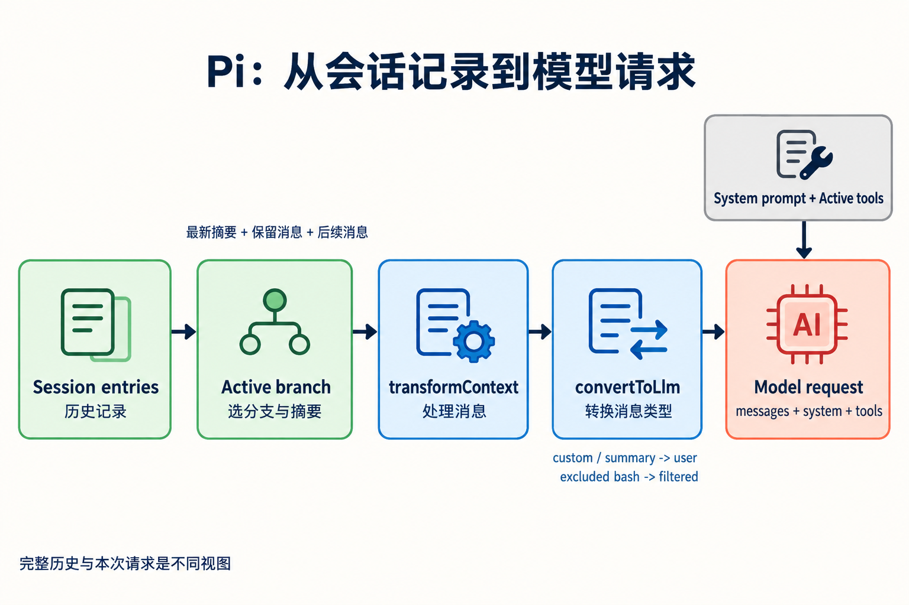
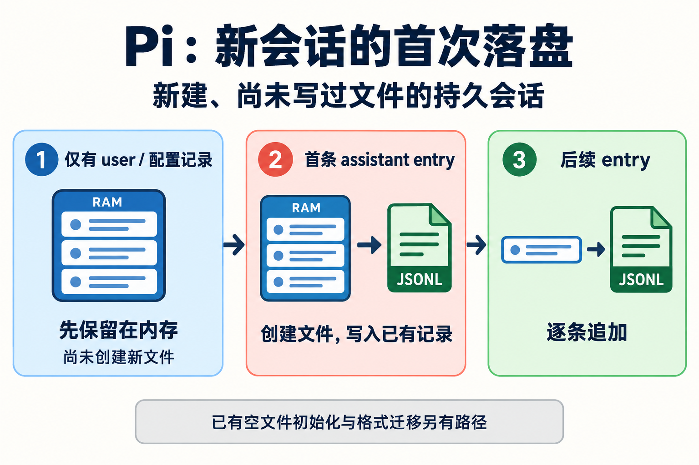
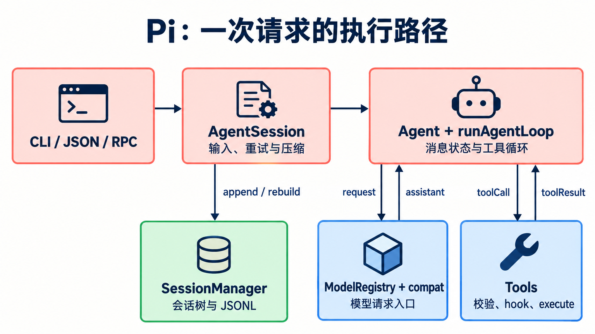

# Pi Agent Harness 分析报告：从一次请求看懂它怎样工作

打开 Pi，输入一句话：

> 看一下这个项目的配置，告诉我服务监听哪个端口。

屏幕上很快出现一次文件读取，接着是回答：“8080。”这个过程看起来像模型自己打开了文件。但在模型提出读取请求之后，还需要程序找到工具、检查参数、访问文件，再把内容交回模型。我们看到的一次回答，实际上已经经过了几次不同的交接。

Pi 把这套运行程序称为 agent harness。要理解它，可以先跟着这条请求走一遍，再看任务变长、遇到错误或需要换一个方向时，系统会怎样处理。下文基于 Pi `v0.80.7` 的当前 Coding Agent 实现；读取配置等场景是串讲源码的示例，实际实验记录放在文末的查证入口。

## 模型提出动作，Pi 把动作做完

模型收到请求时，除了你的问题，还会收到系统提示、已有消息，以及当前可以使用的工具说明。Pi 新会话默认开放 `read`、`bash`、`edit` 和 `write`：读取文件、执行命令、修改文本和写入文件。仓库里还定义了其他工具，只是默认没有全部启用。

对于端口问题，模型可能先返回一个 `read` 调用，参数是配置文件路径。这条响应表达了“接下来需要读取什么”。Pi 接手之后才会去查找工具、校验参数、执行读取，并把结果包装成一条与该调用关联的消息，也就是 `toolResult`。

假设文件中写着 `{"port": 8080}`。Pi 把这段结果加入上下文，再请求一次模型。第二次，模型已经有了文件内容，才给出“服务监听 8080 端口”的回答。

因此，一次用户提问可以包含多次模型请求。在 Pi 的低层循环里，一轮模型响应加上它提出的工具处理叫一个 `turn`。上面的例子有两个 turn：第一轮要求读文件并取得结果，第二轮根据结果回答。模型如果在一条响应中提出多个工具调用，它们也可以属于同一个 turn。

这条闭环在源码中由 `runAgentLoop` 执行。围绕它，`Agent` 管理当前消息、工具配置和输入队列，`AgentSession` 则负责把用户输入、扩展、重试和会话管理接起来。先记住这层关系就够了：循环负责持续推进模型和工具之间的交接，产品层负责组织整次运行。[循环与实际 read 轨迹](00-task-walkthrough.md)

## 两个文件一起读，结果怎样接回来

把问题稍微扩大一点：你让 Pi 同时检查配置文件和启动脚本。模型可能一次提出两个读取调用。Pi 默认允许工具并行执行，其中一个文件先读完，界面就可以先显示它的结束通知。

但下一次模型请求里的结果顺序，仍按模型最初提出调用的顺序组织。


*图中的 A、B 是顺序示例：完成通知可以是 B、A，回填给模型的结果仍是 A、B。时间条不表示实测耗时。*

这让界面进度和对话历史各自遵循合适的顺序：界面反映哪个操作先结束，模型看到的消息则保留稳定的调用与结果关系。如果批次中有工具声明需要串行，或配置要求串行，Pi 会让整个批次按顺序执行。

工具执行前还有准备步骤。名称不存在、参数不合法，或者扩展明确阻断调用时，Pi 可以直接返回错误结果，跳过真正的执行函数。一个容易忽略的细节是，`tool_execution_start` 事件在这些检查之前就已经发出。它表示开始处理一次调用，不能单凭这个事件认定文件已被修改或命令已经启动。

如果测试命令确实执行了，但返回失败，错误通常会作为工具结果交回模型。模型读到报错后，可以修改代码，再提出新的测试调用。这仍是刚才那条模型—工具循环。[工具批次与事件顺序](03-core-loop.md)

## 你中途说一句话，Pi 会在什么时候听见

假设 Pi 正在检查文件，你发现它方向不对，补充一句：“先看启动脚本，端口可能被环境变量覆盖了。”在默认交互键位下，此时按 Enter 提交，界面就明确把这条普通消息送入 steering 队列。当前模型响应及其工具批次处理完后，循环检查队列，把消息放到下一次模型请求中；入队本身不会撤销已经发出的工具操作。

如果想排在当前工作之后，例如“这一轮完成后，再检查一下文档里的端口说明”，可以用 Alt+Enter 提交。界面会选择 follow-up 队列，等当前工具和 steering 消息都处理完、循环准备停下时再取出。

决定队列的是提交方式，Pi 不会请求 LLM 根据句子意思分类。同一句“忙完之后，再检查文档”，按 Enter 仍进入 steering，按 Alt+Enter 才进入 follow-up。前一种情况下，模型较早收到消息后，也许会理解“忙完之后”并选择稍后执行；那属于模型收到内容后的行动选择，和程序何时递交消息是两个阶段。

通过 SDK 或 RPC 接入时，由调用方明确指定模式或调用相应的入队方法。快捷键可以自定义；Pi 空闲时，Alt+Enter 则像普通 Enter 一样提交新请求。

两种队列让用户选择何时影响运行：及时调整接下来的方向，或把输入排到当前循环准备结束时。Haochuan 从交互角度讨论过这一区分；具体入口、参数和消费时机见[双队列的实现](03-core-loop.md#双队列对应两种交互意图)。

## 停下来之前，产品层还要处理什么

正常情况下，模型给出回答，工具和输入队列也都耗尽，低层循环就发出 `agent_end`。不过，一次低层运行也可能因为 Pi 请求 LLM 服务失败而结束。

这里需要分清网络错误发生在哪里。如果模型让 bash 执行 curl 下载文件，curl 超时或连接失败，通常会变成错误的 `toolResult`，再交回模型。模型可以决定换地址、检查网络，或者提出 `sleep 10` 后再下载的新命令；这仍是正常工具循环中的下一次决策。

另一种情况是 Pi 自己向 LLM 服务发请求，服务返回了临时的不可用错误。此时轮到 `AgentSession` 处理：它检查最后的错误状态，用代码规则判断错误是否可重试，再看开关和次数限制。默认设置下，连续失败可以额外重试三次，分别等待 2、4、8 秒。等待期间可以取消；后续收到非 error 的响应时，计数会重置。

这一步不需要让 LLM 判断“要不要再试”。分类器检查的是最后的 assistant 错误状态，不会扫描全部工具输出，看到“network error”就重试。符合规则的模型服务或传输错误可以重试，配额和账单限制则会被排除。上下文溢出有另一条压缩恢复路径，也不直接套用普通重试。

因此，同一条用户请求中可能出现这样的过程：第一次低层运行因模型 API 请求失败而发出 `agent_end`，产品层等待后再次调用 `Agent.continue()`，重新请求模型。这不会直接重跑上一条 bash，也不会把用户任务从头执行；模型恢复响应后仍可自行提出新的工具调用。直到重试、压缩和排队输入等后续工作都处理完，`AgentSession` 才发出 `agent_settled`。

这也解释了为什么“运行结束”和“任务做对”要分别检查。重试耗尽后报错退出，产品层同样需要收尾；模型给出一个错误的端口，也可能正常结束。事件告诉我们程序走到了哪里，回答是否正确还要看文件和任务要求。模型 API 错误后的自动重发与模型看到工具失败后主动调整动作，由不同的机制决定。命令自身也可能有重试，例如 curl 的重试选项；那段时间 Pi 通常仍在等待本次 bash 完成。[三层重试的例子](10-implementation-details.md#bash-联网失败和模型-api-失败分别怎么处理)

## 模型看到的历史，是每次请求选出来的

现在假设对话已经持续了一段时间：Pi 读过配置、跑过测试，你还尝试过两种修复方式。会话里积累的内容，已经比最初那句提问丰富得多。

Pi 会保存发生过的消息和其他记录，但模型每次请求使用的是经过选择的视图。完整记录可以包含多条分支，当前只沿其中一条继续；较早的内容也可能已经被压缩摘要代表。随后，扩展可以调整请求用的消息，类型转换函数再把它们整理成模型接口接受的形式。



*消息经过分支选择、变换和类型转换；system prompt 与 active tools 在请求组装处单独加入。有压缩记录时，当前视图包含摘要与保留片段。*

一个具体例子是扩展补充的“不要修改公共 API”。Pi 内部可以把它记成 `custom` 消息，同时保留扩展类型、显示选项和附加数据。发送前，`convertToLlm` 取出它的正文，包装成 pi-ai 的 `user` 消息。因此，模型消息中的 user 角色也可能承载程序加入的上下文，不一定是人刚刚键入的文字。

另一个例子是你直接在 Pi 中执行 `!npm test`。应用记录里可以分别保存命令、输出、退出码和取消状态；转换函数再把这些字段组织成模型可读的文本。模型主动调用 bash 工具时，得到的则是与工具调用关联的 `toolResult`。两条路径都涉及 shell，但消息的来源和表示不同。

还有一些扩展记录只是内部状态，例如计数器或界面标记。普通 custom entry 默认不进入模型上下文；需要注入内容时，扩展使用另一种 custom message entry。甚至 `display: false` 也只是界面属性，不能据此推断模型看不到内容。

这些转换都是普通 TypeScript 代码。恢复会话、切换分支或压缩时，Pi 会重建相应的消息视图；正常循环则在内存中追加消息，并在每次模型请求前进行转换。排查“模型为什么没看到某条信息”时，需要沿着这条路径检查，仅仅在 session 文件里找到它还不够。[三层视图与消息转换例子](04-context-memory-compaction.md)

消息到达模型 API 后，还要经过模型服务的编码。Pi 适配器先把 system prompt、消息和工具定义组织成请求字段；服务端再按模型的对话模板加入角色边界、工具说明和生成前缀，随后转成 token 输入。Qwen3.8-27B 与 DeepSeek V4 Flash 的公开实现使用不同的标记和工具调用格式。模型生成的调用经过解析回到 Pi，真正的文件读取仍由 Pi 执行。这个交接解释了为什么同一份 messages 可以对应不同的模型输入。[从 API 请求到模型输入的完整例子](18-model-input-encoding.md)

## 对话太长时，摘要怎样接上后续工作

排查启动问题的时间一长，配置文件、命令输出和修改记录会不断进入对话。Pi 会把较早内容总结成摘要，保留一段近期消息，让后续请求继续容纳新的工作。

哪些原文留下，先由代码按预算和消息结构决定。当前默认 `keepRecentTokens` 是 20000：程序从最新消息往前累计估算 token，找到保留近期片段的切分位置。它按体积选择连续片段，不会先让模型给每条消息打重要性分数；工具结果也不能成为保留片段的第一条，以免失去对应的工具调用。

假设这次选中了最近约两万 token 的消息，之前的内容就交给模型总结。摘要提示词要求记录用户目标和约束、工作进度、关键决定、下一步，以及继续任务需要的文件路径和错误信息。若一次排查本身就很长，切分位置落在任务中途，Pi 还会为被切掉的任务前半段生成摘要，交代原始要求和早期进展，让留下来的后半段有上下文可接。

下面用一个教学例子表示压缩后的对话；消息编号和体积只用于说明过程：

```text
原来：消息 1～80 + 消息 81～100
之后：前面工作的摘要 + 保留原文的消息 81～100
```

摘要成功后，`AgentSession` 保存带有摘要和保留起点的压缩记录，再重建当前上下文。旧消息仍可留在会话文件中。较早的重要要求要靠摘要传递，近期细节则继续保有原文；摘要是否遗漏关键约束，需要检查内容，不能只看“压缩完成”事件。[切分边界与摘要生成](04-context-memory-compaction.md#哪些消息保留原文哪些送去总结)

假如摘要正在生成，你补充一句：“生产环境设置了 PORT=8080，接下来检查 Docker 配置。”终端会先把这句话放进压缩期间的输入队列。正在进行的摘要调用继续处理之前准备好的材料，新要求等压缩结束再提交。下一次处理任务的模型请求就可以看到：

```text
压缩摘要 + 保留的近期消息 + “PORT=8080，请检查 Docker 配置”
```

如果上一轮已经完成，这条输入可以启动后续工作；如果正在为溢出错误做恢复，它会按提交时的 steering / follow-up 类型进入相应队列，由恢复后的循环消费。接收输入和开始处理输入发生在不同时间。[压缩期间的队列时间线](04-context-memory-compaction.md#压缩期间提交的新输入怎样接上来)

Pi 还区分接近阈值时的预防性压缩，以及上下文溢出后的恢复。阈值检查发生在特定运行边界，检查之后仍可能加入大段输入或工具输出，估算也可能与实际用量有差异，所以提前压缩不能排除所有溢出。已完成的回答不会因为阈值压缩而重新生成；需要恢复的溢出响应才按规则尝试压缩后续跑。[为什么仍然需要溢出恢复](04-context-memory-compaction.md#已经有阈值检查为什么还会溢出)

## 关掉进程之后，对话怎样继续

要让这段工作延续到下次启动，Pi 用 `SessionManager` 管理会话记录。记录以 JSONL 保存，也就是每行一个 JSON 对象；其中的 `id` 和 `parentId` 把历史连接成树，当前的 `leaf` 表示继续对话的位置。

这使得尝试另一种思路时，不必删掉原来的路径。比如，你先尝试修改配置，随后回到共同历史，改为检查启动参数。两条路径都可以留在会话树中，模型沿当前选中的分支继续。切换时还可以附带支线摘要，把有用的信息带回来。Armin 的使用记录把这种能力用于临时探索：先解决支线问题，再回到主线。[会话分支与使用案例](08-sessions-persistence-recovery.md#会话树怎样支持临时探索)

会话分支管理的是对话。支线里如果已经修改了文件，回到旧 leaf 后，文件仍然是修改后的内容；工作区版本需要用 Git 等方式另行管理。这个区别在尝试不同修复方案时尤其重要。

文件的创建时机也有一个细节：新建且尚未写过的持久会话，通常先把 user 和配置 entry 留在内存，直到首条 assistant entry 出现后才创建文件并写入已有记录，之后再逐条追加。



*图示新建、尚未写过文件的会话。已有空文件初始化和格式迁移有另外的处理路径。*

重新打开会话时，Pi 根据记录重建当前分支、模型设置和压缩后的消息视图。历史实验中，两个独立进程通过同一 session 恢复了之前保存的合成信息。这验证了正常保存后的恢复路径；它没有替代进程崩溃、半写入文件或工作区漂移的故障检查。[持久化与恢复细节](08-sessions-persistence-recovery.md)

## 工作流需要改变时，扩展接在哪里

读到这里，Pi 的运行主线已经比较清楚：准备请求、调用模型、执行工具、处理结果，再管理继续和结束。Extensions 可以在这些交接位置参与处理。

例如，项目需要限制某类文件修改，可以在工具执行前检查调用并阻断；需要给下一次请求补充项目状态，可以调整请求消息；工具返回了丰富的结构化数据，也可以分别安排模型看到的内容和界面显示的数据。扩展因此能改动运行行为，而不只是增加一个菜单命令。

这种能力依赖明确的生命周期。`AgentSession.reload()` 会刷新设置和资源、重建 extension runner 与工具注册表，再按条件发送重新启动通知。扩展若需要跨 reload 保留状态，可以利用会话记录；旧的内存 closure 不会因此自动变成持久状态。[扩展状态与 reload](05-models-tools-extensions.md#扩展怎样形成可迭代的工作流)

运行权限也需要放在同一张图景里理解。Pi 默认工具和 extensions 使用启动进程的权限。Project trust 管的是项目启动资源加载，工具 hook 管的是经过它的调用，实际文件和网络隔离则由部署环境提供。一个确认对话框并不会自动覆盖扩展自己发起的所有副作用。[信任与执行边界](06-permissions-sandbox-workspace.md)

Mario 的设计回顾强调对上下文和交互过程的控制。对应到当前代码，这个方向体现为请求、工具、状态和生命周期上的多个可调整入口。它能解释为什么读 Pi 时，除了看循环本身，还需要看这些交接位置由谁持有、何时更新。

## 把这些机制放回最初的请求

现在再看“读取配置，告诉我端口”这件事，可以把职责放回源码中的几个对象。

`AgentSession` 接收并准备输入，组织 extensions 和产品级收尾。`Agent` 保存当前消息、工具配置和队列，由 `runAgentLoop` 推进一轮轮模型与工具处理。模型请求经过 `ModelRegistry` 和兼容适配入口，消息记录则交给 `SessionManager` 管理。



*循环分别请求模型和调度工具，再接收各自的结果；会话管理保存记录。图中聚合了职责，具体事件和落盘时机在前文展开。*

如果请求成功，一次用户输入可以经过多个 turn 后结束；如果遇到可重试错误，产品层可能启动另一段低层运行；如果历史太长，后续请求会改用摘要与保留片段。最终看到的回答，来自模型选择动作与程序维护这些状态和边界的共同过程。

## 继续阅读与查证

正文以读取配置等例子串起机制。另有一条保留的真实 read 轨迹：模型读取合成文件中的 `314159` 后，在第二轮给出答案。网络失败和配置修改等叙述用于说明源码规则，未拼接进这条真实轨迹。

分析固定于 `v0.80.7 / 818d674` 的当前产品路径。历史真实模型记录与本地受控测试支持的范围不同，详见下列资料；本次只是重组文章，没有新增运行实验。

- [专题阅读与查证索引](reading-guide.md)：按问题进入源码、消息示例和实现细节。
- [真实请求轨迹](00-task-walkthrough.md)、[实验记录](11-runtime-experiments.md)与[复现方法](13-coverage-reproducibility.md)：查看实际验证过什么。
- [外部解读与源码对照](17-external-perspectives.md)：查看作者、使用者文章及其版本边界。
- [结论与证据索引](14-source-claim-index.md)、[术语表](16-glossary.md)：查找具体字段、事件和源码位置。

文中插图沿用同一组已复核的机制说明。[图像元数据](../diagrams/generated/metadata.json)保留对应证据、生成参数和审核记录。
